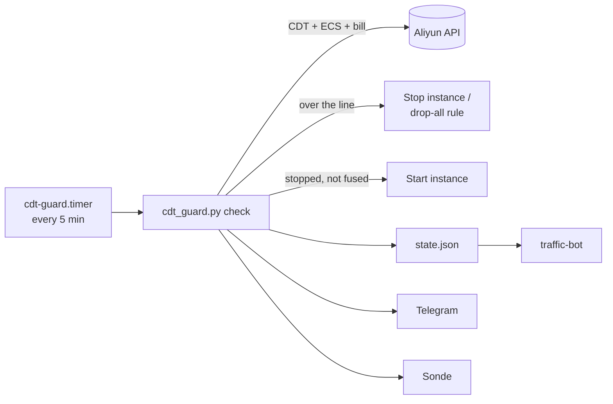

# CDT-Management _(cdt-guard)_

**English** · [简体中文](README.zh-CN.md)

Aliyun CDT traffic and cost fuse for one ECS instance: stops it before the free quota runs out and restarts it next month.

```text
$ python3 /opt/cdt-guard/cdt_guard.py report
☁️ Aliyun CDT · 海外/香港
▓▓▓▓▓▓▓░░░ 75.8%
已用 151.62 / 200 GB · 熔断线 199 GB · 余 47.38 GB
速率 0.00 GB/h
hk-cdt · Running · 203.0.113.10
守护 ✅ 正常
刚刚更新
```
*`report` output (sample instance). Program output is in Chinese.*

## Contents

- [Why cdt-guard?](#-why-cdt-guard)
- [Highlights](#-highlights)
- [Quick Start](#-quick-start)
- [Installation](#-installation)
- [Usage](#-usage)
- [Configuration](#-configuration)
- [Update & Maintenance](#-update--maintenance)
- [How It Works](#-how-it-works)
- [Security](#-security)
- [Development](#-development)
- [Documentation](#-documentation)
- [License](#-license)

## 💡 Why cdt-guard?

Aliyun CDT gives 200 GB of free Hong Kong/overseas traffic a month (20 GB for mainland China); past that you pay per GB, and a runaway bill can hit your card overnight. cdt-guard checks usage and the month's bill every 5 minutes from another machine and stops the instance (or blocks it in the security group) before the line is crossed.

- ✅ Good fit: one personal ECS instance on the CDT free quota, guarded from an always-on Debian box elsewhere.
- ❌ Not a fit: several instances or accounts, or wanting a web panel — see the reference projects in the [manual](docs/MANUAL.zh-CN.md#常见问题).

## ✨ Highlights

- **Traffic fuse** — stops the instance (or adds a drop-all security-group rule) at 199 GB by default.
- **Early fuse** — projects the last 90 minutes' rate 30 minutes ahead to cover CDT's reporting delay.
- **Cost fuse** — stops the instance when this month's bill reaches `COST_LIMIT` (default 5 USD), whatever the mode.
- **Keep-alive** — restarts the instance after a spot reclaim or an accidental stop; releases the fuse in the new month.
- **Fail-safe** — if the Aliyun API fails, it does nothing; a sudden low reading mid-month never releases the fuse.
- **Notifications** — Telegram for every action; optional [Sonde](https://github.com/10ta/Sonde) panel; [traffic-bot](../traffic-bot/) shows it without an Aliyun key.
- **No dependencies** — Python standard library plus a systemd timer.

## 🚀 Quick Start

Run as root on an always-on Debian/Ubuntu machine that is **not** the instance being guarded. Have a RAM user AccessKey ready ([how](docs/MANUAL.zh-CN.md#前置准备)).

```bash
curl -fsSL https://raw.githubusercontent.com/10ta/scripts-de-moi/main/CDT-Management/init.sh -o /tmp/cdt-init.sh
bash /tmp/cdt-init.sh
```

The script asks for the AccessKey and region, verifies them on the spot, lists your instances to pick from, then asks for the fuse line, mode and Telegram settings. It ends with a usage report like the one above; the timer is then running every 5 minutes.

## 📦 Installation

### Requirements

| Component | Version | Notes |
|---|---|---|
| Debian / Ubuntu with systemd | Debian 11+ | Must be a different machine from the guarded ECS |
| Python | ≥ 3.8 | Installed by `init.sh` if missing |
| Network | — | Reaches `*.aliyuncs.com`; `api.telegram.org` if notifications are on |
| Aliyun RAM user | — | Least-privilege policy: [`ram-policy.json`](ram-policy.json) |

### From a clone

```bash
git clone https://github.com/10ta/scripts-de-moi.git /opt/scripts-de-moi
cd /opt/scripts-de-moi/CDT-Management
bash init.sh
```

`init.sh` installs to `/opt/cdt-guard/`, writes `/etc/cdt-guard.env` (mode 600), and enables `cdt-guard.timer`. Running it again keeps the existing config and only updates the program files.

### Verify

```bash
systemctl list-timers cdt-guard.timer
# NEXT … LEFT … cdt-guard.timer cdt-guard.service
```

## 🧭 Usage

### Check status

```bash
bash init.sh status
```

Shows the timer, the last 5 log lines and a fresh usage report.

### Pause auto-start before maintenance

```bash
python3 /opt/cdt-guard/cdt_guard.py hold
python3 /opt/cdt-guard/cdt_guard.py release
```

Without `hold`, an instance you stop by hand is started again within 10 minutes.

### Let traffic through mid-month

Raise `CDT_LIMIT_GB` (or `COST_LIMIT`) in `/etc/cdt-guard.env`, then:

```bash
python3 /opt/cdt-guard/cdt_guard.py unlock
```

Within the same month the fuse only lifts this way; it lifts by itself only after the billing month (Beijing time) changes and the reading drops under the release line.

→ Choosing `stop` vs `sg`, testing keep-alive and spot-instance caveats: [manual](docs/MANUAL.zh-CN.md#熔断方式怎么选).

## 🔧 Configuration

All settings live in `/etc/cdt-guard.env` and take effect on the next check; no restart needed. Template: [`cdt-guard.env.example`](cdt-guard.env.example).

| Name | Required | Default | Description |
|---|---|---|---|
| `ALI_AK` / `ALI_SK` | ✅ | — | RAM user AccessKey |
| `ALI_REGION` | ✅ | — | Instance region, e.g. `cn-hongkong` |
| `ALI_INSTANCE_ID` | ✅ | — | Instance to guard |
| `CDT_LIMIT_GB` | ❌ | `199` | Fuse line for this month's traffic |
| `CDT_QUOTA_GB` | ❌ | `200` / `20` | Free quota; picked from the region's pool |
| `CDT_RELEASE_GB` | ❌ | limit − 10 | Release line, applied only after the month changes |
| `CDT_LOOKAHEAD_MIN` | ❌ | `30` | Early-fuse projection window (minutes) |
| `GUARD_MODE` | ❌ | `stop` | `stop` = shut down; `sg` = drop-all inbound rule |
| `STOP_MODE` | ❌ | `KeepCharging` | Pay-as-you-go only; `StopCharging` frees the IP |
| `SG_ID` | ❌ | first group | Security group for `sg` mode |
| `GUARD_KEEPALIVE` | ❌ | `1` | Start the instance when found stopped |
| `COST_LIMIT` | ❌ | `5` | Cost fuse in USD (intl) / CNY (cn); `0` = off |
| `COST_WARN_PCT` | ❌ | `50` | Warn once at this % of `COST_LIMIT` |
| `COST_CHECK_MIN` | ❌ | `30` | Minutes between bill queries |
| `ALI_SITE` | ❌ | `intl` | `intl` or `cn` account site |
| `TG_BOT_TOKEN` / `TG_CHAT_ID` | ❌ | — | Telegram notifications (comma-separated chats) |
| `SONDE_URL` / `SONDE_TOKEN` | ❌ | — | Sonde panel reporting |
| `STATE_DIR` | ❌ | `/var/lib/cdt-guard` | State directory |

## 🔄 Update & Maintenance

### Update

```bash
cd /opt/scripts-de-moi
./CDT-Management/update.sh
```

Or `./update.sh` at the repo root to update every tool installed on this machine.

### Data & backup

| Path | Content |
|---|---|
| `/etc/cdt-guard.env` | Config and AccessKey (root, 600) — back this up |
| `/var/lib/cdt-guard/state.json` | Fuse state and last reading (644, read by traffic-bot) |

### Logs

```bash
journalctl -u cdt-guard -f
```

### Uninstall

```bash
bash init.sh uninstall
```

Removes the timer, service and `/opt/cdt-guard`; in `sg` mode it first deletes its security-group rule. Config and state are kept, and the command to delete them is printed. A stopped instance stays stopped.

## 🧠 How It Works



- **Runs on another machine** → a stopped instance cannot start itself.
- **API failure means no action** → a failed query is never read as 0 GB; 3 failures in a row send one alert.
- **The fuse lifts only in a new month** → an empty or low reading mid-month (API glitch, back-filled data) keeps the fuse on.
- **State-changing calls are sent once** → a timed-out stop or start is not repeated; the next check sees the real state.
- **Time budget** → if the traffic and instance queries take over 60 s, the bill query is skipped that round so the run finishes before systemd's 300 s timeout.
- **Sonde gets changes plus a 15-minute heartbeat** → about 96 reports a day instead of 288.

## 🔒 Security

- Use a RAM user with [`ram-policy.json`](ram-policy.json), not the main account key. `AliyunECSFullAccess` can delete any instance in the account.
- The AccessKey sits only in `/etc/cdt-guard.env` (root, 600).
- `state.json` is world-readable so traffic-bot can read it; it holds the instance ID and public IP.
- Telegram and Sonde messages are scrubbed of IPs, domains, URLs and instance IDs.

## 🔨 Development

```bash
python3 -m unittest discover CDT-Management/tests
```

Tests start a fake Aliyun API through `ALI_ENDPOINT_OVERRIDE`, so no account is needed. They cover the fuse, month change, single-attempt actions, failure counting and the Sonde heartbeat.

## 📚 Documentation

- [docs/MANUAL.zh-CN.md](docs/MANUAL.zh-CN.md): Full Chinese manual — RAM user setup, fuse modes, cost-fuse caveats, FAQ.
- [cdt-guard.env.example](cdt-guard.env.example): Every config key with comments.
- [ram-policy.json](ram-policy.json): Least-privilege RAM policy.
- [../AGENTS.md](../AGENTS.md): Conventions and checks for AI coding agents working on this repo.

## 📄 License

No license file yet; all rights reserved by default. See the [repository README](../README.md#-license).
