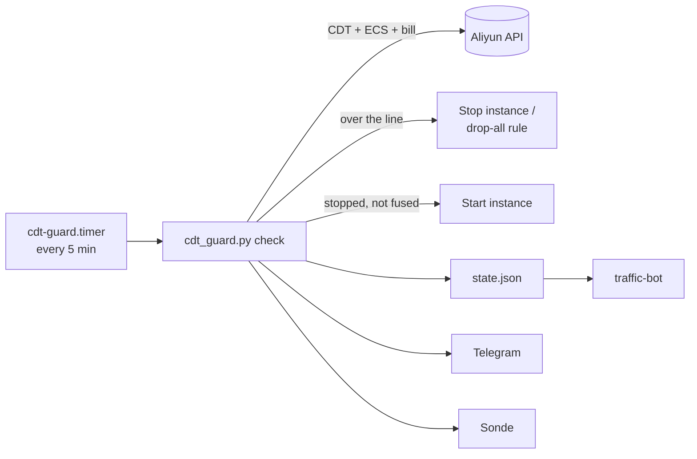

# CDT-Management _(cdt-guard)_

[English](README.md) · **简体中文**

阿里云 CDT 流量与费用熔断：免费额度用完前把 ECS 停下，下个月自动开回来。

```text
$ python3 /opt/cdt-guard/cdt_guard.py report
☁️ Aliyun CDT · 海外/香港
▓▓▓▓▓▓▓░░░ 75.8%
已用 151.62 / 200 GB · 熔断线 199 GB · 余 47.38 GB
速率 0.00 GB/h
hk-cdt · Running · 203.0.113.10
守护 ✅ 正常
刚刚更新
```
*`report` 的输出（示例实例）。*

## 目录

- [为什么是 cdt-guard？](#-为什么是-cdt-guard)
- [亮点](#-亮点)
- [快速开始](#-快速开始)
- [安装](#-安装)
- [使用](#-使用)
- [配置](#-配置)
- [更新与维护](#-更新与维护)
- [工作原理](#-工作原理)
- [安全](#-安全)
- [开发](#-开发)
- [文档地图](#-文档地图)
- [许可](#-许可)

## 💡 为什么是 cdt-guard？

阿里云 CDT 每月有 200 GB 免费的香港 / 海外流量（中国内地 20 GB），超出按量计费，失控的话一夜就能刷爆信用卡。cdt-guard 在另一台机器上每 5 分钟查一次流量和本月账单，在越线之前把实例关机（或在安全组里封禁）。

- ✅ 适用：一台个人 ECS，用 CDT 免费额度，由别处一台常开的 Debian 守护。
- ❌ 不适用：要守护多台实例或多个账号、想要 Web 面板——见[手册](docs/MANUAL.zh-CN.md#常见问题)里的参考项目。

## ✨ 亮点

- **流量熔断**：默认 199 GB 时关机（或加一条 drop-all 安全组规则）。
- **提前熔断**：按近 90 分钟的速率往后推 30 分钟，弥补 CDT 数据的延迟。
- **费用熔断**：本月账单到 `COST_LIMIT`（默认 5 USD）就关机，不管熔断方式是什么。
- **保活**：抢占回收、误关之后自动开机；新的一个月自动解除熔断。
- **出错不乱动**：查询阿里云失败时什么都不做；月中读数突然变低也不会解除熔断。
- **通知**：每个动作都推 Telegram；可选 [Sonde](https://github.com/10ta/Sonde) 面板；[traffic-bot](../traffic-bot/) 不用阿里云 AK 也能显示。
- **零依赖**：只用 Python 标准库加一个 systemd timer。

## 🚀 快速开始

在一台常开的 Debian / Ubuntu 上以 root 运行，这台机器**不能**是被守护的那台实例。先准备好 RAM 用户的 AccessKey（[怎么拿](docs/MANUAL.zh-CN.md#前置准备)）。

```bash
curl -fsSL https://raw.githubusercontent.com/10ta/scripts-de-moi/main/CDT-Management/init.sh -o /tmp/cdt-init.sh
bash /tmp/cdt-init.sh
```

脚本会问 AccessKey 和地域并当场验证，列出实例让你选，再问熔断线、熔断方式和 Telegram 设置。最后打印一份和上面一样的用量报告，此时定时器已经在每 5 分钟运行一次。

## 📦 安装

### 前置要求

| 组件 | 版本 | 说明 |
|---|---|---|
| 带 systemd 的 Debian / Ubuntu | Debian 11+ | 必须和被守护的 ECS 不是同一台 |
| Python | ≥ 3.8 | 没有的话 `init.sh` 会自动装 |
| 网络 | — | 能访问 `*.aliyuncs.com`；开了通知还要能访问 `api.telegram.org` |
| 阿里云 RAM 用户 | — | 最小权限策略：[`ram-policy.json`](ram-policy.json) |

### 从仓库安装

```bash
git clone https://github.com/10ta/scripts-de-moi.git /opt/scripts-de-moi
cd /opt/scripts-de-moi/CDT-Management
bash init.sh
```

`init.sh` 把程序装到 `/opt/cdt-guard/`，写 `/etc/cdt-guard.env`（权限 600），启用 `cdt-guard.timer`。重复运行会保留已有配置，只更新程序文件。

### 验证

```bash
systemctl list-timers cdt-guard.timer
# NEXT … LEFT … cdt-guard.timer cdt-guard.service
```

## 🧭 使用

### 查看状态

```bash
bash init.sh status
```

显示定时器、最近 5 行日志和一份实时用量报告。

### 维护前暂停自动开机

```bash
python3 /opt/cdt-guard/cdt_guard.py hold
python3 /opt/cdt-guard/cdt_guard.py release
```

不先 `hold` 的话，手动关掉的实例最多 10 分钟后会被开回来。

### 月中放行

在 `/etc/cdt-guard.env` 里调高 `CDT_LIMIT_GB`（或 `COST_LIMIT`），然后：

```bash
python3 /opt/cdt-guard/cdt_guard.py unlock
```

同一个月里只能这样解除；自动解除要等账单月（北京时间）换了、并且读数回落到解除线以下。

→ `stop` 和 `sg` 怎么选、怎么测试保活、抢占式实例的注意事项：见[手册](docs/MANUAL.zh-CN.md#熔断方式怎么选)。

## 🔧 配置

全部写在 `/etc/cdt-guard.env`，下一轮检查自动生效，不用重启。模板：[`cdt-guard.env.example`](cdt-guard.env.example)。

| 名称 | 必填 | 默认值 | 说明 |
|---|---|---|---|
| `ALI_AK` / `ALI_SK` | ✅ | — | RAM 用户的 AccessKey |
| `ALI_REGION` | ✅ | — | 实例地域，如 `cn-hongkong` |
| `ALI_INSTANCE_ID` | ✅ | — | 要守护的实例 |
| `CDT_LIMIT_GB` | ❌ | `199` | 本月流量的熔断线 |
| `CDT_QUOTA_GB` | ❌ | `200` / `20` | 免费额度，按地域所在的池自动判断 |
| `CDT_RELEASE_GB` | ❌ | 熔断线 − 10 | 解除线，只在换月之后生效 |
| `CDT_LOOKAHEAD_MIN` | ❌ | `30` | 提前熔断的预测窗口（分钟） |
| `GUARD_MODE` | ❌ | `stop` | `stop` = 关机；`sg` = 加 drop-all 入站规则 |
| `STOP_MODE` | ❌ | `KeepCharging` | 仅按量付费；`StopCharging` 会释放公网 IP |
| `SG_ID` | ❌ | 第一个安全组 | `sg` 模式用的安全组 |
| `GUARD_KEEPALIVE` | ❌ | `1` | 发现停机就开机 |
| `COST_LIMIT` | ❌ | `5` | 费用熔断线，国际站 USD / 中国站 CNY；`0` = 关闭 |
| `COST_WARN_PCT` | ❌ | `50` | 到 `COST_LIMIT` 的这个百分比时提醒一次 |
| `COST_CHECK_MIN` | ❌ | `30` | 多少分钟查一次账单 |
| `ALI_SITE` | ❌ | `intl` | 账号站点：`intl` 或 `cn` |
| `TG_BOT_TOKEN` / `TG_CHAT_ID` | ❌ | — | Telegram 通知（多个 chat 用逗号分隔） |
| `SONDE_URL` / `SONDE_TOKEN` | ❌ | — | 上报 Sonde 面板 |
| `STATE_DIR` | ❌ | `/var/lib/cdt-guard` | 状态目录 |

## 🔄 更新与维护

### 更新

```bash
cd /opt/scripts-de-moi
./CDT-Management/update.sh
```

或者在仓库根目录运行 `./update.sh`，一起更新本机装了的所有工具。

### 数据与备份

| 路径 | 内容 |
|---|---|
| `/etc/cdt-guard.env` | 配置和 AccessKey（root，600）——备份它 |
| `/var/lib/cdt-guard/state.json` | 熔断状态和最近一次读数（644，traffic-bot 读它） |

### 日志

```bash
journalctl -u cdt-guard -f
```

### 卸载

```bash
bash init.sh uninstall
```

删除定时器、服务和 `/opt/cdt-guard`；`sg` 模式会先删掉它加的安全组规则。配置和状态保留，并打印彻底删除的命令。已经关机的实例不会被开回来。

## 🧠 工作原理



- **装在另一台机器上** → 实例关机后没法自己开机。
- **API 出错就不动作** → 查询失败绝不当成 0 GB；连续失败 3 次推一次告警。
- **只在新的月份解除熔断** → 月中读数突然为空或变低（接口故障、数据补算）时保持熔断。
- **会改状态的操作只发一次** → 关机或开机超时不重发，下一轮按实际状态处理。
- **时间预算** → 流量和实例查询超过 60 秒时，这一轮跳过账单查询，保证在 systemd 的 300 秒超时前跑完。
- **Sonde 变化即报 + 15 分钟心跳** → 每天约 96 次上报，原来是 288 次。

## 🔒 安全

- 用 RAM 用户加 [`ram-policy.json`](ram-policy.json)，不要用主账号的 AK。`AliyunECSFullAccess` 能删掉账号下任何实例。
- AccessKey 只存在 `/etc/cdt-guard.env`（root，600）。
- `state.json` 所有人可读，方便 traffic-bot 读取；里面有实例 ID 和公网 IP。
- Telegram 和 Sonde 消息会去掉 IP、域名、网址和实例 ID。

## 🔨 开发

```bash
python3 -m unittest discover CDT-Management/tests
```

测试通过 `ALI_ENDPOINT_OVERRIDE` 起一个假的阿里云 API，不需要账号。覆盖熔断、换月、单次动作、失败计数和 Sonde 心跳。

## 📚 文档地图

- [docs/MANUAL.zh-CN.md](docs/MANUAL.zh-CN.md)：完整中文手册——RAM 用户怎么建、熔断方式、费用熔断的注意事项、常见问题。
- [cdt-guard.env.example](cdt-guard.env.example)：全部配置项和注释。
- [ram-policy.json](ram-policy.json)：RAM 最小权限策略。
- [../AGENTS.md](../AGENTS.md)：给 AI 编码代理的约定和检查清单。

## 📄 许可

还没有许可证文件，默认保留所有权利。见[仓库 README](../README.zh-CN.md#-许可)。
