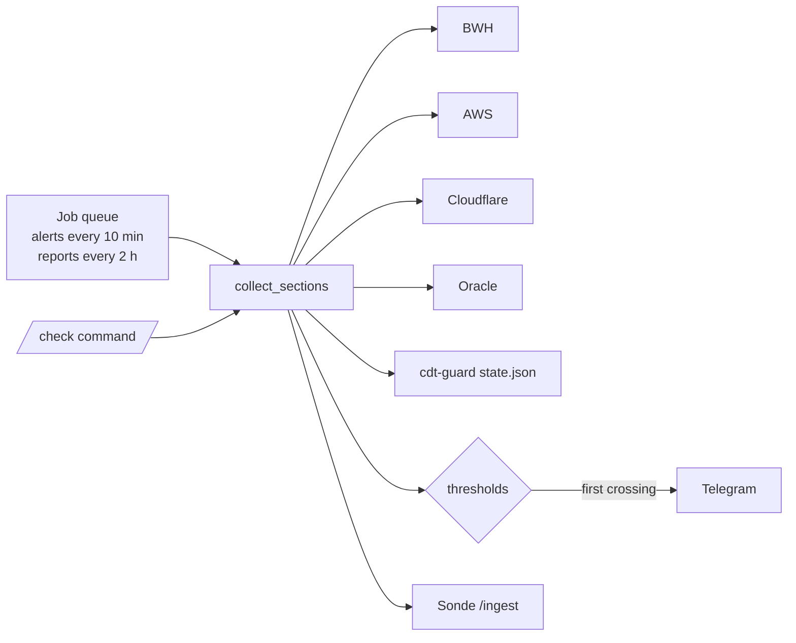

# traffic-bot

**English** · [简体中文](README.zh-CN.md)

A Telegram bot that tracks free-tier usage across BWH, AWS, Cloudflare, Oracle Cloud and Aliyun CDT, and alerts at 80% / 95%.

```text
🟧 Aliyun CDT  本月 · 海外/香港
✅ 流量  ▰▰▰▰▰▰▰▰▱▱  75.8%
└ 152GB / 200GB · 剩 48.4GB
🛡 ✅ 守护中 · 熔断线 199GB（关机）· 距熔断 47.4GB
🖥 hk-cdt · Running · 有公网IP · 速率 0.42GB/h
🔄 30天后重置 (Dec.1 00:00:00) · 日均可用 1.6GB
💰 本月应付 0.31 / 熔断 5 USD （账单有几小时延迟）
```
*One block of a `/check` reply, rendered as plain text from sample data. Messages are in Chinese.*
<!-- TODO: add a real Telegram screenshot at docs/assets/check.png -->

## Contents

- [Why traffic-bot?](#-why-traffic-bot)
- [Highlights](#-highlights)
- [Quick Start](#-quick-start)
- [Deployment](#-deployment)
- [Usage](#-usage)
- [Configuration](#-configuration)
- [Update & Maintenance](#-update--maintenance)
- [How It Works](#-how-it-works)
- [Security](#-security)
- [Development](#-development)
- [Documentation](#-documentation)
- [License](#-license)

## 💡 Why traffic-bot?

Free tiers are spread over half a dozen consoles, each with its own reset day, and going over usually means a surprise bill. traffic-bot queries every provider's API on a schedule, posts one combined report to Telegram, and pushes an alert the first time a quota crosses a threshold.

- ✅ Good fit: one person watching personal VPS, CDN and serverless quotas from a small Debian server.
- ❌ Not a fit: team billing dashboards or Vercel (Vercel has no public usage API).

## ✨ Highlights

- **One report, seven sources** — BWH, Lightsail, CloudFront, AWS bill, Cloudflare (Workers & Pages, R2, D1, CDN), Oracle Cloud, Aliyun CDT.
- **Alerts once per threshold** — each quota alerts once per period per threshold; restarts don't repeat alerts.
- **Worker CPU health** — per-Worker P50/P90/P99 against the 10 ms free limit, plus calls killed for CPU or memory.
- **No paid API calls** — CloudWatch `GetMetricStatistics` / `ListMetrics` only; Cost Explorer is never used.
- **One slow provider doesn't stall the rest** — each source has a 90 s limit; a stuck one shows "查询超时" for that round.
- **Redacted output** — no IPs, domains or URLs in Telegram messages or [Sonde](https://github.com/10ta/Sonde) reports.

## 🚀 Quick Start

Requires Debian/Ubuntu with systemd and Python 3.9+, run as root. Have a bot token from @BotFather and your chat ID ready ([how](docs/MANUAL.zh-CN.md#准备凭据)).

```bash
apt install -y python3-venv
git clone https://github.com/10ta/scripts-de-moi.git /opt/scripts-de-moi
cd /opt/scripts-de-moi/traffic-bot
bash install.sh
```

The installer asks for each credential (press Enter to skip a provider) and starts the service. Send `/check` to the bot — you should get a report within a few seconds.

## 🚢 Deployment

### Bare metal (systemd)

`install.sh` does the whole deployment:

1. Creates the system user `trafficbot` and installs `bot.py` plus a venv in `/opt/traffic-bot/`.
2. Installs `python-telegram-bot[job-queue]`, `boto3`, `requests` and `oci`.
3. Writes `/etc/traffic-bot.env` (root, 600). Re-running it keeps existing values and appends any new keys.
4. Copies the Oracle key to `/etc/traffic-bot/oci_api_key.pem` (root:trafficbot, 640).
5. Installs and starts `traffic-bot.service` (sandboxed, `Restart=always`).

Each provider needs a read-only credential. Step-by-step setup for every console is in the [manual](docs/MANUAL.zh-CN.md#准备凭据).

### Aliyun CDT

No bot config and no Aliyun key: install [CDT-Management](../CDT-Management/) on the same machine and the bot reads `/var/lib/cdt-guard/state.json`.

## 🧭 Usage

Only chats in `ALLOWED_CHAT_IDS` can use the bot; others are ignored and logged.

| Command | What it does |
|---|---|
| `/start` | Help text (allowed chats get scheduled reports from startup anyway) |
| `/check` | Query every provider |
| `/cloudfront`, `/cf` | CloudFront only |
| `/cloudflare` | Cloudflare only |
| `/bill`, `/awsbill` | AWS bill only (skips the bill cache) |
| `/oracle`, `/oci` | Oracle Cloud only |
| `/aliyun`, `/cdt` | Aliyun CDT only |
| `/help` | Command list |

Alerts: every `ALERT_CHECK_MINUTES` the bot checks all quotas; the first time one crosses a step in `ALERT_THRESHOLDS`, it pushes "🚨 用量告警". The record resets when the period (day or month) changes.

## 🔧 Configuration

All settings live in `/etc/traffic-bot.env` as `KEY="value"`. Restart after editing: `systemctl restart traffic-bot`. Providers you leave empty are hidden, except Lightsail and CloudFront, which always run.

| Name | Required | Default | Description |
|---|---|---|---|
| `BOT_TOKEN` | ✅ | — | Telegram bot token |
| `ALLOWED_CHAT_IDS` | ✅ | — | Comma-separated chats allowed to use the bot |
| `REPORT_INTERVAL_HOURS` | ❌ | `2` | Scheduled report interval; `0` = off |
| `ALERT_THRESHOLDS` | ❌ | `80,95` | Alert steps (%) |
| `ALERT_CHECK_MINUTES` | ❌ | `10` | How often thresholds are checked |
| `REPORT_TZ` | ❌ | `America/New_York` | Time zone used for display |
| `PROVIDER_TIMEOUT_SEC` | ❌ | `90` | Per-provider query limit (s) |
| `SLOW_CACHE_MIN` | ❌ | `60` | Cache for Cloudflare billing-period usage and the Oracle instance list (min) |
| `BWH_API_KEY` / `BWH_VEID` | ❌ | — | BandwagonHost KiwiVM API |
| `BWH_TOTAL_GB` / `BWH_NAME` | ❌ | `2000` / plan name | Plan transfer; card name in Sonde |
| `AWS_ACCESS_KEY` / `AWS_SECRET_KEY` | ❌ | boto3 chain | Read-only IAM user |
| `LIGHTSAIL_REGION` | ❌ | `ap-northeast-1` | Lightsail region |
| `AWS_BILL` / `AWS_BILL_LIMIT_USD` / `AWS_BILL_CACHE_MIN` | ❌ | `1` / `1` / `60` | AWS bill section, alert line, cache |
| `CLOUDFRONT_LIMIT_GB` / `CLOUDFRONT_LIMIT_REQUESTS` | ❌ | `1024` / `10000000` | CloudFront free tier |
| `CLOUDFLARE_API_TOKEN` / `CLOUDFLARE_ACCOUNT_ID` | ❌ | — | Both needed to show Cloudflare |
| `CLOUDFLARE_ZONES` | ❌ | all zones | `name=ZoneID,…` when the token lacks Zone Read |
| `CLOUDFLARE_BILLING_DAY` | ❌ | `8` | Workers billing-period start day (UTC) |
| `CLOUDFLARE_PAGES_FUNCTIONS` | ❌ | `1` | Count Pages Functions in Workers requests |
| `CF_WORKERS_DAILY_LIMIT` / `CF_WORKERS_CPU_MS` | ❌ | `100000` / `10` | Workers free tier |
| `CF_R2_STORAGE_GB` / `CF_R2_CLASS_A` / `CF_R2_CLASS_B` | ❌ | `10` / `1000000` / `10000000` | R2 free tier |
| `CF_D1_ROWS_READ` / `CF_D1_ROWS_WRITTEN` | ❌ | `5000000` / `100000` | D1 daily free tier |
| `CF_D1_STORAGE_GB` / `CF_D1_DB_MAX_MB` | ❌ | `5` / `500` | D1 storage limits |
| `OCI_TENANCY` / `OCI_USER` / `OCI_FINGERPRINT` | ❌ | — | All three needed to show Oracle |
| `OCI_REGION` / `OCI_KEY_FILE` | ❌ | `ap-seoul-1` / `/etc/traffic-bot/oci_api_key.pem` | Oracle region and private key |
| `OCI_EGRESS_LIMIT_TB` | ❌ | `10` | Monthly free egress |
| `OCI_IDLE_CHECK` / `OCI_IDLE_LINE` / `OCI_IDLE_WARN` | ❌ | `0` / `20` / `25` | Idle-reclaim check |
| `CDT_STATE_PATH` / `CDT_STALE_MIN` | ❌ | `/var/lib/cdt-guard/state.json` / `15` | cdt-guard state file and staleness alert |
| `SONDE_URL` / `SONDE_TOKEN` | ❌ | — | Sonde panel reporting |

## 🔄 Update & Maintenance

### Update

```bash
cd /opt/scripts-de-moi
./traffic-bot/update.sh
```

It pulls the repo, re-runs `install.sh` (keeps config, adds new keys), restarts the service and checks that it really restarted.

### Data & backup

| Path | Content |
|---|---|
| `/etc/traffic-bot.env` | All config and keys (root, 600) — back this up |
| `/etc/traffic-bot/oci_api_key.pem` | Oracle private key (root:trafficbot, 640) |
| `/var/lib/traffic-bot/alerts.json` | Alert de-duplication; entries unseen for 7 days are dropped |

### Logs

```bash
journalctl -u traffic-bot -f
```

Each round logs one line with the time spent per provider, e.g. `本轮查询 6.2s：BWH 0.4s · Lightsail 1.1s · …`.

### Uninstall

```bash
./traffic-bot/uninstall.sh
```

Removes the service and `/opt/traffic-bot`; config, the Oracle key, alert state and the `trafficbot` user are kept, and the command to delete them is printed.

## 🧠 How It Works



- **Providers run in threads, each with a time limit** → blocking SDK calls never freeze the bot; a hung provider costs at most 90 s.
- **Results are cached for 30 s** → a report and an alert check that land together share one round of API calls.
- **Slow-changing data is cached for 60 min** → the Cloudflare billing-period scan and the Oracle inventory aren't re-fetched every 10 minutes.
- **Oracle retries are capped at 3 attempts / 60 s** → the SDK default (8 attempts / 600 s) could hold a round for 10 minutes.
- **CPU P90 is shown but not alerted on** → it swings around the limit; alerts fire only on a 24 h breach or killed calls.

## 🔒 Security

- Set `ALLOWED_CHAT_IDS`; without it anyone who finds the bot can read your usage.
- Use read-only credentials for every provider (IAM policy, Cloudflare token scopes, OCI policies are in the [manual](docs/MANUAL.zh-CN.md#准备凭据)).
- Keys live only in `/etc/traffic-bot.env` (root, 600); the service runs as `trafficbot` with `ProtectSystem=strict`.
- Outgoing text passes through `scrub()`, which replaces IPs, URLs and domains with `***`.

## 🔨 Development

```bash
/opt/traffic-bot/venv/bin/python -m unittest discover traffic-bot/tests
```

Tests need the bot's dependencies (use the deployed venv) but no network. They cover the per-provider timeout, alert-state pruning, field-fallback memory, the slow cache and Sonde payload redaction.

## 📚 Documentation

- [docs/MANUAL.zh-CN.md](docs/MANUAL.zh-CN.md): Full Chinese manual — getting each credential, Sonde card layout, FAQ.
- [install.sh](install.sh): The env template written on first install.
- [../CDT-Management/README.md](../CDT-Management/README.md): The guard that feeds the Aliyun CDT section.
- [../AGENTS.md](../AGENTS.md): Conventions and checks for AI coding agents working on this repo.

## 📄 License

No license file yet; all rights reserved by default. See the [repository README](../README.md#-license).
