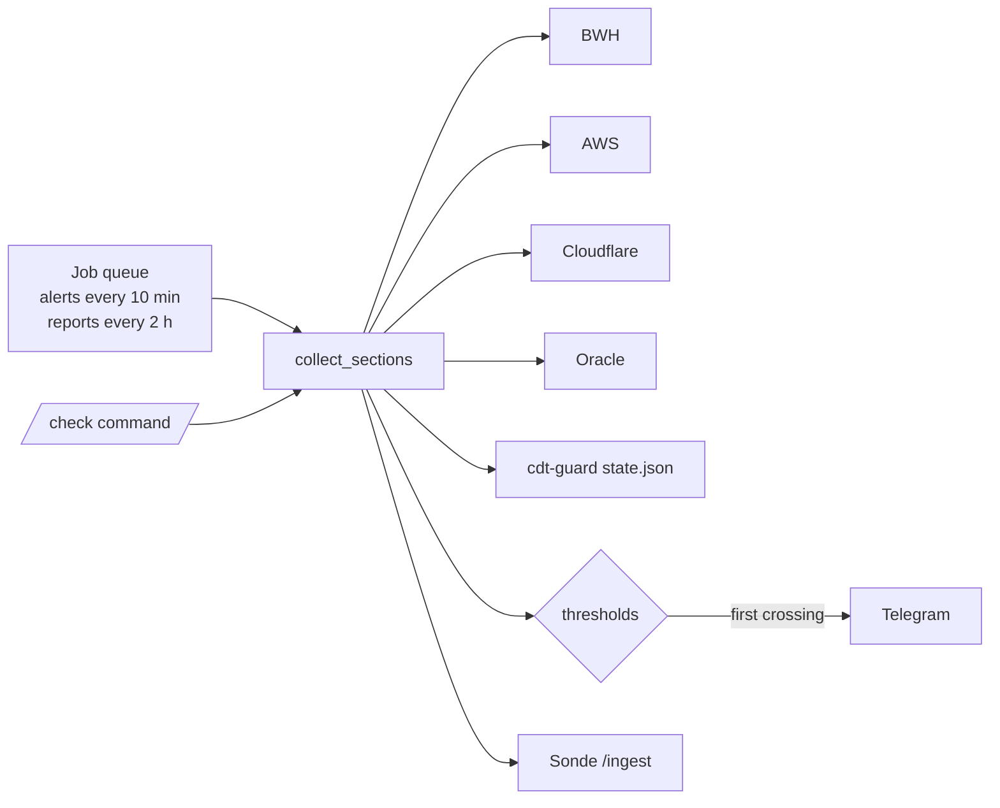

# traffic-bot

[English](README.md) · **简体中文**

一个 Telegram 机器人：汇总 BWH、AWS、Cloudflare、Oracle Cloud、阿里云 CDT 的免费额度用量，越过 80% / 95% 时告警。

```text
🟧 Aliyun CDT  本月 · 海外/香港
✅ 流量  ▰▰▰▰▰▰▰▰▱▱  75.8%
└ 152GB / 200GB · 剩 48.4GB
🛡 ✅ 守护中 · 熔断线 199GB（关机）· 距熔断 47.4GB
🖥 hk-cdt · Running · 有公网IP · 速率 0.42GB/h
🔄 30天后重置 (Dec.1 00:00:00) · 日均可用 1.6GB
💰 本月应付 0.31 / 熔断 5 USD （账单有几小时延迟）
```
*`/check` 回复中的一块，用示例数据渲染成纯文本。*
<!-- TODO: add a real Telegram screenshot at docs/assets/check.png -->

## 目录

- [为什么是 traffic-bot？](#-为什么是-traffic-bot)
- [亮点](#-亮点)
- [快速开始](#-快速开始)
- [部署](#-部署)
- [使用](#-使用)
- [配置](#-配置)
- [更新与维护](#-更新与维护)
- [工作原理](#-工作原理)
- [安全](#-安全)
- [开发](#-开发)
- [文档地图](#-文档地图)
- [许可](#-许可)

## 💡 为什么是 traffic-bot？

免费额度分散在好几个控制台里，各有各的重置日，超了往往就是一张意外的账单。traffic-bot 定时查询各家的 API，把汇总报告发到 Telegram，某项额度第一次越过阈值时立即推送告警。

- ✅ 适用：一个人在一台小 Debian 上盯着自己的 VPS、CDN、Serverless 额度。
- ❌ 不适用：团队账单看板；Vercel（没有公开的用量接口）。

## ✨ 亮点

- **一份报告，七个来源**：BWH、Lightsail、CloudFront、AWS 账单、Cloudflare（Workers & Pages、R2、D1、CDN）、Oracle Cloud、阿里云 CDT。
- **每档只告警一次**：每项额度每个周期每个阈值只推一次；重启 bot 不会重复告警。
- **Worker CPU 健康**：每个 Worker 的 P50 / P90 / P99 对比免费版 10 ms 上限，以及因超 CPU 或内存被终止的次数。
- **不调收费接口**：CloudWatch 只用 `GetMetricStatistics` / `ListMetrics`，从不调用 Cost Explorer。
- **一个来源卡住不拖累其他**：每个来源最多查 90 秒，卡住的那个本轮显示「查询超时」。
- **输出已脱敏**：Telegram 消息和 [Sonde](https://github.com/10ta/Sonde) 上报里没有 IP、域名、网址。

## 🚀 快速开始

需要带 systemd 的 Debian / Ubuntu、Python 3.9+，以 root 运行。先准备好 @BotFather 给的 bot token 和你的 chat ID（[怎么拿](docs/MANUAL.zh-CN.md#准备凭据)）。

```bash
apt install -y python3-venv
git clone https://github.com/10ta/scripts-de-moi.git /opt/scripts-de-moi
cd /opt/scripts-de-moi/traffic-bot
bash install.sh
```

安装脚本会逐项询问凭据（不用的平台直接回车跳过），然后启动服务。给 bot 发 `/check`，几秒内应该收到一份报告。

## 🚢 部署

### 裸机（systemd）

`install.sh` 完成全部部署：

1. 创建系统用户 `trafficbot`，把 `bot.py` 和虚拟环境装到 `/opt/traffic-bot/`。
2. 安装 `python-telegram-bot[job-queue]`、`boto3`、`requests`、`oci`。
3. 写 `/etc/traffic-bot.env`（root，600）。重复运行会保留已有的值，只追加新的配置项。
4. 把 Oracle 私钥复制到 `/etc/traffic-bot/oci_api_key.pem`（root:trafficbot，640）。
5. 安装并启动 `traffic-bot.service`（沙箱化，`Restart=always`）。

每个平台都需要一份只读凭据，各个控制台的逐步说明见[手册](docs/MANUAL.zh-CN.md#准备凭据)。

### 阿里云 CDT

bot 不需要任何配置，也不需要阿里云 AK：在同一台机器上装 [CDT-Management](../CDT-Management/)，bot 会读 `/var/lib/cdt-guard/state.json`。

## 🧭 使用

只有 `ALLOWED_CHAT_IDS` 里的 chat 能用这个 bot，其他人的消息会被忽略并记日志。

| 命令 | 作用 |
|---|---|
| `/start` | 显示说明（白名单里的 chat 启动时就会自动开始定时播报） |
| `/check` | 查询全部平台 |
| `/cloudfront`、`/cf` | 只查 CloudFront |
| `/cloudflare` | 只查 Cloudflare |
| `/bill`、`/awsbill` | 只查 AWS 账单（跳过账单缓存） |
| `/oracle`、`/oci` | 只查 Oracle Cloud |
| `/aliyun`、`/cdt` | 只查阿里云 CDT |
| `/help` | 命令列表 |

告警：每 `ALERT_CHECK_MINUTES` 分钟检查一次全部额度；某项第一次越过 `ALERT_THRESHOLDS` 里的一档时，推送「🚨 用量告警」。周期（天 / 月）切换后记录自动清零。

## 🔧 配置

全部写在 `/etc/traffic-bot.env`，格式为 `KEY="value"`。改完要重启：`systemctl restart traffic-bot`。留空的平台不显示，Lightsail 和 CloudFront 例外，它们总会查询。

| 名称 | 必填 | 默认值 | 说明 |
|---|---|---|---|
| `BOT_TOKEN` | ✅ | — | Telegram bot token |
| `ALLOWED_CHAT_IDS` | ✅ | — | 允许使用 bot 的 chat，逗号分隔 |
| `REPORT_INTERVAL_HOURS` | ❌ | `2` | 定时播报间隔，`0` = 关闭 |
| `ALERT_THRESHOLDS` | ❌ | `80,95` | 告警档位（%） |
| `ALERT_CHECK_MINUTES` | ❌ | `10` | 多久检查一次阈值 |
| `REPORT_TZ` | ❌ | `America/New_York` | 显示时间用的时区 |
| `PROVIDER_TIMEOUT_SEC` | ❌ | `90` | 单个来源最多查多久（秒） |
| `SLOW_CACHE_MIN` | ❌ | `60` | Cloudflare 账期用量和 Oracle 实例清单的缓存时间（分钟） |
| `BWH_API_KEY` / `BWH_VEID` | ❌ | — | 搬瓦工 KiwiVM API |
| `BWH_TOTAL_GB` / `BWH_NAME` | ❌ | `2000` / 套餐名 | 套餐流量；Sonde 上的卡片名 |
| `AWS_ACCESS_KEY` / `AWS_SECRET_KEY` | ❌ | boto3 凭证链 | 只读 IAM 用户 |
| `LIGHTSAIL_REGION` | ❌ | `ap-northeast-1` | Lightsail 区域 |
| `AWS_BILL` / `AWS_BILL_LIMIT_USD` / `AWS_BILL_CACHE_MIN` | ❌ | `1` / `1` / `60` | AWS 账单板块、告警线、缓存 |
| `CLOUDFRONT_LIMIT_GB` / `CLOUDFRONT_LIMIT_REQUESTS` | ❌ | `1024` / `10000000` | CloudFront 免费额度 |
| `CLOUDFLARE_API_TOKEN` / `CLOUDFLARE_ACCOUNT_ID` | ❌ | — | 两项都填才显示 Cloudflare |
| `CLOUDFLARE_ZONES` | ❌ | 全部域名 | Token 没有 Zone Read 时手动填 `名称=ZoneID,…` |
| `CLOUDFLARE_BILLING_DAY` | ❌ | `8` | Workers 账期起始日（UTC） |
| `CLOUDFLARE_PAGES_FUNCTIONS` | ❌ | `1` | 把 Pages Functions 计入 Workers 请求数 |
| `CF_WORKERS_DAILY_LIMIT` / `CF_WORKERS_CPU_MS` | ❌ | `100000` / `10` | Workers 免费额度 |
| `CF_R2_STORAGE_GB` / `CF_R2_CLASS_A` / `CF_R2_CLASS_B` | ❌ | `10` / `1000000` / `10000000` | R2 免费额度 |
| `CF_D1_ROWS_READ` / `CF_D1_ROWS_WRITTEN` | ❌ | `5000000` / `100000` | D1 每日免费额度 |
| `CF_D1_STORAGE_GB` / `CF_D1_DB_MAX_MB` | ❌ | `5` / `500` | D1 存储上限 |
| `OCI_TENANCY` / `OCI_USER` / `OCI_FINGERPRINT` | ❌ | — | 三项都填才显示 Oracle |
| `OCI_REGION` / `OCI_KEY_FILE` | ❌ | `ap-seoul-1` / `/etc/traffic-bot/oci_api_key.pem` | Oracle 区域和私钥 |
| `OCI_EGRESS_LIMIT_TB` | ❌ | `10` | 每月免费出站流量 |
| `OCI_IDLE_CHECK` / `OCI_IDLE_LINE` / `OCI_IDLE_WARN` | ❌ | `0` / `20` / `25` | 闲置回收检测 |
| `CDT_STATE_PATH` / `CDT_STALE_MIN` | ❌ | `/var/lib/cdt-guard/state.json` / `15` | cdt-guard 状态文件和过期提醒 |
| `SONDE_URL` / `SONDE_TOKEN` | ❌ | — | 上报 Sonde 面板 |

## 🔄 更新与维护

### 更新

```bash
cd /opt/scripts-de-moi
./traffic-bot/update.sh
```

它会拉取代码、重新运行 `install.sh`（保留配置、补上新配置项）、重启服务，并确认确实重启了。

### 数据与备份

| 路径 | 内容 |
|---|---|
| `/etc/traffic-bot.env` | 全部配置和密钥（root，600）——备份它 |
| `/etc/traffic-bot/oci_api_key.pem` | Oracle 私钥（root:trafficbot，640） |
| `/var/lib/traffic-bot/alerts.json` | 告警去重记录；7 天没出现的条目自动删除 |

### 日志

```bash
journalctl -u traffic-bot -f
```

每一轮都会打一行各来源的耗时，例如 `本轮查询 6.2s：BWH 0.4s · Lightsail 1.1s · …`。

### 卸载

```bash
./traffic-bot/uninstall.sh
```

删除服务和 `/opt/traffic-bot`；配置、Oracle 私钥、告警记录和 `trafficbot` 用户保留，并打印彻底删除的命令。

## 🧠 工作原理



- **每个来源在线程里跑，各有时限** → 阻塞的 SDK 调用不会卡住 bot；卡死的来源最多占 90 秒。
- **结果缓存 30 秒** → 定时播报和告警检查撞在一起时共用一轮 API 调用。
- **变化慢的数据缓存 60 分钟** → Cloudflare 账期扫描和 Oracle 实例清单不必每 10 分钟查一遍。
- **Oracle 重试限制为 3 次 / 60 秒** → SDK 默认（8 次 / 600 秒）可能把一轮拖上 10 分钟。
- **CPU P90 只显示不告警** → 它会在上限附近来回波动；只有近 24 小时也超限、或有调用被终止时才推送。

## 🔒 安全

- 一定要设置 `ALLOWED_CHAT_IDS`；不设的话，任何找到这个 bot 的人都能看到你的用量。
- 每个平台都用只读凭据（IAM 策略、Cloudflare Token 权限、OCI 策略见[手册](docs/MANUAL.zh-CN.md#准备凭据)）。
- 密钥只存在 `/etc/traffic-bot.env`（root，600）；服务以 `trafficbot` 用户运行，开了 `ProtectSystem=strict`。
- 发出去的文字都经过 `scrub()`，IP、网址、域名替换成 `***`。

## 🔨 开发

```bash
/opt/traffic-bot/venv/bin/python -m unittest discover traffic-bot/tests
```

测试需要 bot 的依赖（用部署好的 venv），不需要联网。覆盖单个来源超时、告警记录清理、字段回退的记忆、慢数据缓存、Sonde 上报脱敏。

## 📚 文档地图

- [docs/MANUAL.zh-CN.md](docs/MANUAL.zh-CN.md)：完整中文手册——每个平台的凭据怎么拿、Sonde 卡片结构、常见问题。
- [install.sh](install.sh)：首次安装时写入的配置模板。
- [../CDT-Management/README.zh-CN.md](../CDT-Management/README.zh-CN.md)：给阿里云 CDT 板块提供数据的守护程序。
- [../AGENTS.md](../AGENTS.md)：给 AI 编码代理的约定和检查清单。

## 📄 许可

还没有许可证文件，默认保留所有权利。见[仓库 README](../README.zh-CN.md#-许可)。
