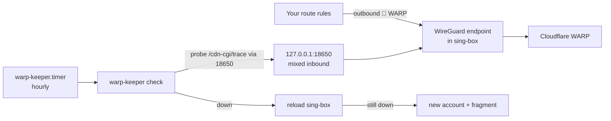

# warp-keeper

**English** · [简体中文](README.zh-CN.md)

Keeps a Cloudflare WARP exit alive inside sing-box: registers, writes a WireGuard endpoint, checks hourly, self-heals. No wireproxy.

```text
$ warp-keeper --help
warp-keeper —— 给 sing-box 自动维护一个 Cloudflare WARP 出口，不需要 wireproxy / wg-quick

  warp-keeper.sh init        注册账户（已有就沿用）→ 写 sing-box 配置片段 → 检查 → 重载 → 验证
  warp-keeper.sh check       健康检查，不通就按「重载 → 换号」逐级自愈（timer 每小时调用）
  warp-keeper.sh status      看当前状态：出口、延迟、账户、可用率（会实测一次，不改任何东西）
  warp-keeper.sh renew       立即换一个新账户（想换出口 IP 时用）
  warp-keeper.sh plus [KEY]  给当前账户套 WARP+ 许可证；不带 KEY 就从 env 里 WARP_PLUS 指定的来源取
  warp-keeper.sh sync        按当前版本和 env 重新生成片段，有变化才重载（update.sh 用）
  warp-keeper.sh remove      删掉配置片段、重载 sing-box、注销账户（主配置还在引用 tag 时会拒绝）
```
*Command help (abridged). Output is in Chinese.*

## Contents

- [Why warp-keeper?](#-why-warp-keeper)
- [Highlights](#-highlights)
- [Quick Start](#-quick-start)
- [Installation](#-installation)
- [Usage](#-usage)
- [Configuration](#-configuration)
- [Update & Maintenance](#-update--maintenance)
- [How It Works](#-how-it-works)
- [Security](#-security)
- [Documentation](#-documentation)
- [License](#-license)

## 💡 Why warp-keeper?

The usual setup — a WARP account from a one-off script, copied by hand into a sing-box endpoint, or wireproxy running next to sing-box — breaks silently when Cloudflare drops the account. warp-keeper puts the endpoint into its own sing-box config fragment, probes it every hour through a local inbound, and repairs it step by step.

- ✅ Good fit: a VPS running sing-box ≥ 1.11 under systemd with a config directory (`-C`), routing some traffic out via WARP.
- ❌ Not a fit: sing-box started from a single `-c` file you don't want to change, or a machine without sing-box.

## ✨ Highlights

- **No extra process** — the tunnel is sing-box's own userspace WireGuard endpoint; the check is a timer that exits.
- **Main config untouched** — a separate `00-warp-keeper.json` fragment is merged by sing-box at load.
- **Drop-in for wireproxy** — a `127.0.0.1:18650` mixed inbound replaces the old `socks5://127.0.0.1:18650`.
- **Step-by-step self-healing** — rule out sing-box down / network down → reload sing-box → register a new account; every change is `sing-box check`ed and rolled back if the new one fails.
- **WARP+** — optionally pulls public licences; falls back to free.
- **Observable** — Telegram alerts, recovery notices and a daily summary; one Sonde card for all machines.

## 🚀 Quick Start

Requires sing-box ≥ 1.11 managed by systemd with `-C <config dir>`, run as root.

```bash
git clone https://github.com/10ta/scripts-de-moi.git /opt/scripts-de-moi
cd /opt/scripts-de-moi/warp-keeper
./install.sh
warp-keeper init
systemctl enable --now warp-keeper.timer
```

`init` ends with a Telegram "已部署" message (if configured) and `warp-keeper status` shows `IPv4 ✅ WARP · 出口 …` for each stack. Migrating from wireproxy? Read [the migration steps](docs/MANUAL.zh-CN.md#从-fscarmen-脚本的-wireproxy-迁移) first.

## 📦 Installation

### Requirements

| Component | Version | Notes |
|---|---|---|
| sing-box | ≥ 1.11 | WireGuard endpoints arrived in 1.11; install with [upsing](../docs/upsing.md) |
| systemd unit with `-C <dir>` | — | The official `.deb` already starts with `-C /etc/sing-box` |
| `curl`, `jq`, `ss`, `flock` | — | Installed by `install.sh` if missing |

### What `install.sh` changes

- Installs `/opt/warp-keeper/warp-keeper.sh` and links it as `/usr/local/bin/warp-keeper`.
- Installs `warp-keeper.service` / `.timer` (3 min after boot, then hourly with up to 5 min jitter).
- Copies `/etc/warp-keeper.env` on first install only. It never touches sing-box or the account.

> [!WARNING]
> `init`, an automatic account renewal and a fragment change all **reload sing-box**, which briefly drops every inbound connection, not just WARP. The hourly check only reloads when WARP is actually down.

## 🧭 Usage

### See the current state

```bash
warp-keeper status
```

Probes once and prints exits, latency, account type, renewals and 24 h / 7 d availability; changes nothing.

### Get a new exit IP

```bash
warp-keeper renew
```

Registers a new account, swaps the fragment, reloads, probes; on failure it rolls back to the old one.

### Apply a WARP+ licence

```bash
warp-keeper plus xxxxxxxx-xxxxxxxx-xxxxxxxx
```

No reload needed; it takes effect on the next handshake.

## 🔧 Configuration

Settings live in `/etc/warp-keeper.env`; run `warp-keeper init` after editing (keeps the account, reloads only if the fragment changed). Template: [`warp-keeper.env.example`](warp-keeper.env.example).

| Name | Required | Default | Description |
|---|---|---|---|
| `WARP_NAME` | ❌ | hostname | Name in Telegram and Sonde |
| `WARP_TAG` | ❌ | `🧩 <WARP>` | Endpoint tag your route rules point to; must be unique |
| `LOCAL_PORT` | ❌ | `18650` | Local mixed inbound used for probing |
| `STACK` | ❌ | `dual` | `dual`, `v4` or `v6` |
| `MTU` | ❌ | `1280` | WireGuard MTU |
| `PEER` / `PEER_PORT` | ❌ | `auto` / `2408` | Peer address and port |
| `SB_SERVICE` / `SB_CONFIG_DIR` | ❌ | `sing-box` / from unit | sing-box service and config directory |
| `FRAGMENT_NAME` | ❌ | `00-warp-keeper.json` | Fragment file name (sort order matters) |
| `RENEW_MIN_GAP` | ❌ | `360` | Minutes between automatic renewals |
| `WARP_PLUS` | ❌ | `off` (template: `auto`) | `auto`, `off`, or licence keys |
| `TIMEZONE` | ❌ | `Asia/Taipei` | Time zone for messages and the daily summary |
| `TG_BOT_TOKEN` / `TG_CHAT_ID` | ❌ | — | Telegram |
| `TG_NOTIFY` / `TG_REPEAT_HOURS` / `TG_SUMMARY_HOUR` | ❌ | `change` / `6` / `9` | When to message; daily summary hour |
| `SONDE_URL` / `SONDE_TOKEN` | ❌ | — | Sonde panel reporting |

## 🔄 Update & Maintenance

### Update

```bash
cd /opt/scripts-de-moi
./warp-keeper/update.sh
```

Reinstalls the program, then runs `warp-keeper sync`: if the regenerated fragment is identical nothing happens; otherwise check → reload → probe, with rollback on failure.

### Data & backup

`/var/lib/warp-keeper/` (700): `account.json` (device ID, token, private key), `state`, `checks.log` (8 days of results), `fragment.prev`, `bad-keys`.

### Logs

```bash
journalctl -u warp-keeper --output cat
```

### Uninstall

Remove route rules that use `WARP_TAG` from the main config first, then:

```bash
./warp-keeper/uninstall.sh
```

It runs `warp-keeper remove` (delete fragment → check → reload → deregister) and only then deletes the units and program. Config and state are kept.

## 🧠 How It Works



- **Fragment, not edits** → sing-box merges every `.json` in the `-C` directory; `00-` sorts first so the probe rule precedes yours.
- **Probe through the real path** → it fetches `1.1.1.1/cdn-cgi/trace` via the inbound and requires `warp=on` or `plus`.
- **Renewals are rate-limited** → at least `RENEW_MIN_GAP` apart (the registration API returns 429 if you hammer it), unless the account is gone.
- **Every change is reversible** → `sing-box check` before reload, `fragment.prev` for rollback, and a new account is deregistered if it doesn't work.

## 🔒 Security

- `account.json` and the fragment hold the WireGuard private key; both are mode 600.
- The registration API is undocumented; request format follows [wgcf](https://github.com/ViRb3/wgcf). Override `WARP_API`, `WARP_UA`, `WARP_CLIENT_VER` in the env if it changes.
- Telegram messages show the WARP exit IP (a Cloudflare address) but no host IPs or domains; Sonde reports carry no IP at all.

## 📚 Documentation

- [docs/MANUAL.zh-CN.md](docs/MANUAL.zh-CN.md): Full Chinese manual — fragment merging, wireproxy migration, self-healing table, WARP+, notifications.
- [warp-keeper.env.example](warp-keeper.env.example): Every config key with comments.
- [../AGENTS.md](../AGENTS.md): Conventions and checks for AI coding agents working on this repo.

## 📄 License

No license file yet; all rights reserved by default. See the [repository README](../README.md#-license).
