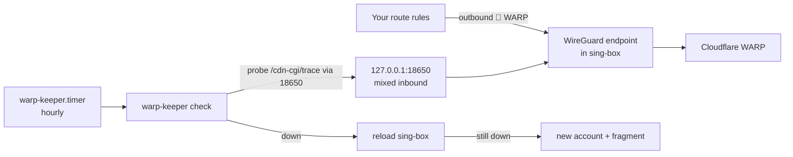

# warp-keeper

[English](README.md) · **简体中文**

在 sing-box 里自动维护一个 Cloudflare WARP 出口：注册账户、写 WireGuard endpoint、每小时检查、不通自愈。不需要 wireproxy。

```text
$ warp-keeper --help
warp-keeper —— 给 sing-box 自动维护一个 Cloudflare WARP 出口，不需要 wireproxy / wg-quick

  warp-keeper.sh init        注册账户（已有就沿用）→ 写 sing-box 配置片段 → 检查 → 重载 → 验证
  warp-keeper.sh check       健康检查，不通就按「重载 → 换号」逐级自愈（timer 每小时调用）
  warp-keeper.sh status      看当前状态：出口、延迟、账户、可用率（会实测一次，不改任何东西）
  warp-keeper.sh renew       立即换一个新账户（想换出口 IP 时用）
  warp-keeper.sh plus [KEY]  给当前账户套 WARP+ 许可证；不带 KEY 就从 env 里 WARP_PLUS 指定的来源取
  warp-keeper.sh sync        按当前版本和 env 重新生成片段，有变化才重载（update.sh 用）
  warp-keeper.sh remove      删掉配置片段、重载 sing-box、注销账户（主配置还在引用 tag 时会拒绝）
```
*命令帮助（节选）。*

## 目录

- [为什么是 warp-keeper？](#-为什么是-warp-keeper)
- [亮点](#-亮点)
- [快速开始](#-快速开始)
- [安装](#-安装)
- [使用](#-使用)
- [配置](#-配置)
- [更新与维护](#-更新与维护)
- [工作原理](#-工作原理)
- [安全](#-安全)
- [文档地图](#-文档地图)
- [许可](#-许可)

## 💡 为什么是 warp-keeper？

常见做法是用一次性脚本注册 WARP 账户，再手动抄进 sing-box 的 endpoint，或者在 sing-box 旁边跑一个 wireproxy；Cloudflare 一旦删掉账户，它就悄悄断了。warp-keeper 把 endpoint 放进 sing-box 的一个独立配置片段，每小时经本机入站探测一次，不通就逐级修复。

- ✅ 适用：VPS 上的 sing-box ≥ 1.11，由 systemd 管理并带配置目录（`-C`），有一部分流量要经 WARP 出去。
- ❌ 不适用：sing-box 用单个 `-c` 文件启动且你不想改；机器上没有 sing-box。

## ✨ 亮点

- **没有额外进程**：隧道就是 sing-box 自己的用户态 WireGuard endpoint；检查是一个跑完就退出的 timer。
- **主配置不用改**：独立的 `00-warp-keeper.json` 片段由 sing-box 加载时合并。
- **直接顶替 wireproxy**：`127.0.0.1:18650` 的 mixed 入站顶替原来的 `socks5://127.0.0.1:18650`。
- **逐级自愈**：先排除 sing-box 没运行 / 本机断网 → 重载 sing-box → 注册新账户；每次改动都先 `sing-box check`，新的不通就回滚。
- **WARP+**：可以自动取公开许可证，套不上就用免费账户。
- **看得见**：Telegram 告警、恢复通知和日报；所有机器共用一张 Sonde 卡片。

## 🚀 快速开始

需要 sing-box ≥ 1.11，由 systemd 管理并带 `-C <配置目录>`，以 root 运行。

```bash
git clone https://github.com/10ta/scripts-de-moi.git /opt/scripts-de-moi
cd /opt/scripts-de-moi/warp-keeper
./install.sh
warp-keeper init
systemctl enable --now warp-keeper.timer
```

`init` 完成后会发一条 Telegram「已部署」消息（配置了的话），`warp-keeper status` 每个栈都显示 `IPv4 ✅ WARP · 出口 …`。从 wireproxy 迁移的话，先看[迁移步骤](docs/MANUAL.zh-CN.md#从-fscarmen-脚本的-wireproxy-迁移)。

## 📦 安装

### 前置要求

| 组件 | 版本 | 说明 |
|---|---|---|
| sing-box | ≥ 1.11 | WireGuard endpoint 从 1.11 开始有；可以用 [upsing](../docs/upsing.zh-CN.md) 安装 |
| 带 `-C <目录>` 的 systemd 单元 | — | 官方 `.deb` 默认就是 `-C /etc/sing-box` |
| `curl`、`jq`、`ss`、`flock` | — | 没有的话 `install.sh` 会装 |

### `install.sh` 会改动什么

- 安装 `/opt/warp-keeper/warp-keeper.sh`，并链接为 `/usr/local/bin/warp-keeper`。
- 安装 `warp-keeper.service` / `.timer`（开机 3 分钟后一次，之后每小时一次，随机延后最多 5 分钟）。
- 只在首次安装时复制 `/etc/warp-keeper.env`。不会碰 sing-box，也不会碰账户。

> [!WARNING]
> `init`、自动换号、片段有变化时都会**重载 sing-box**，所有入站的连接都会断开一下，不只是 WARP。每小时的检查只有确认 WARP 不通时才会重载。

## 🧭 使用

### 查看当前状态

```bash
warp-keeper status
```

实测一次，打印出口、延迟、账户类型、换号次数和 24 小时 / 7 天可用率；不改任何东西。

### 换一个出口 IP

```bash
warp-keeper renew
```

注册新账户、换片段、重载、探测；失败就退回原来的。

### 套用 WARP+ 许可证

```bash
warp-keeper plus xxxxxxxx-xxxxxxxx-xxxxxxxx
```

不用重载，下一次握手后生效。

## 🔧 配置

配置在 `/etc/warp-keeper.env`；改完运行 `warp-keeper init`（沿用现有账户，片段有变化才重载）。模板：[`warp-keeper.env.example`](warp-keeper.env.example)。

| 名称 | 必填 | 默认值 | 说明 |
|---|---|---|---|
| `WARP_NAME` | ❌ | 主机名 | Telegram 和 Sonde 里显示的名字 |
| `WARP_TAG` | ❌ | `🧩 <WARP>` | 路由规则引用的 endpoint tag，不能重名 |
| `LOCAL_PORT` | ❌ | `18650` | 用于探测的本机 mixed 入站 |
| `STACK` | ❌ | `dual` | `dual`、`v4` 或 `v6` |
| `MTU` | ❌ | `1280` | WireGuard MTU |
| `PEER` / `PEER_PORT` | ❌ | `auto` / `2408` | 对端地址和端口 |
| `SB_SERVICE` / `SB_CONFIG_DIR` | ❌ | `sing-box` / 从单元读取 | sing-box 服务名和配置目录 |
| `FRAGMENT_NAME` | ❌ | `00-warp-keeper.json` | 片段文件名（排序有意义） |
| `RENEW_MIN_GAP` | ❌ | `360` | 两次自动换号的最小间隔（分钟） |
| `WARP_PLUS` | ❌ | `off`（模板里是 `auto`） | `auto`、`off` 或许可证本身 |
| `TIMEZONE` | ❌ | `Asia/Taipei` | 消息和日报用的时区 |
| `TG_BOT_TOKEN` / `TG_CHAT_ID` | ❌ | — | Telegram |
| `TG_NOTIFY` / `TG_REPEAT_HOURS` / `TG_SUMMARY_HOUR` | ❌ | `change` / `6` / `9` | 什么时候发消息；日报几点发 |
| `SONDE_URL` / `SONDE_TOKEN` | ❌ | — | 上报 Sonde 面板 |

## 🔄 更新与维护

### 更新

```bash
cd /opt/scripts-de-moi
./warp-keeper/update.sh
```

重新安装程序后运行 `warp-keeper sync`：新生成的片段和现在一样就什么都不做；不一样就 check → 重载 → 探测，失败回滚。

### 数据与备份

`/var/lib/warp-keeper/`（700）：`account.json`（设备 ID、令牌、私钥）、`state`、`checks.log`（近 8 天的结果）、`fragment.prev`、`bad-keys`。

### 日志

```bash
journalctl -u warp-keeper --output cat
```

### 卸载

先把主配置里引用 `WARP_TAG` 的路由规则删掉，然后：

```bash
./warp-keeper/uninstall.sh
```

它先运行 `warp-keeper remove`（删片段 → 检查 → 重载 → 注销账户），成功后才删单元和程序。配置和状态保留。

## 🧠 工作原理



- **放片段，不改主配置** → sing-box 会合并 `-C` 目录里所有 `.json`；`00-` 排在最前，探测规则排在你的规则之前。
- **沿真实路径探测** → 经入站请求 `1.1.1.1/cdn-cgi/trace`，要求 `warp=on` 或 `plus`。
- **换号有频率限制** → 两次至少隔 `RENEW_MIN_GAP`（注册接口请求太频繁会返回 429），原账户已被删除时除外。
- **每次改动都能撤回** → 重载前 `sing-box check`，`fragment.prev` 用于回滚，新账户不通就注销。

## 🔒 安全

- `account.json` 和片段文件里有 WireGuard 私钥，权限都是 600。
- 注册接口没有公开文档，请求格式参照 [wgcf](https://github.com/ViRb3/wgcf)。接口变了可以在 env 里覆盖 `WARP_API`、`WARP_UA`、`WARP_CLIENT_VER`。
- Telegram 消息里显示 WARP 出口 IP（Cloudflare 的地址），不含本机 IP 和域名；Sonde 上报里完全没有 IP。

## 📚 文档地图

- [docs/MANUAL.zh-CN.md](docs/MANUAL.zh-CN.md)：完整中文手册——片段合并、wireproxy 迁移、自愈逻辑表、WARP+、通知。
- [warp-keeper.env.example](warp-keeper.env.example)：全部配置项和注释。
- [../AGENTS.md](../AGENTS.md)：给 AI 编码代理的约定和检查清单。

## 📄 许可

还没有许可证文件，默认保留所有权利。见[仓库 README](../README.zh-CN.md#-许可)。
